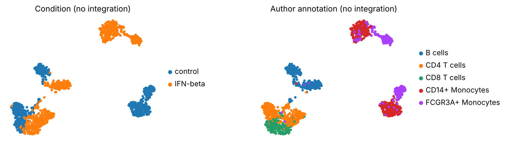
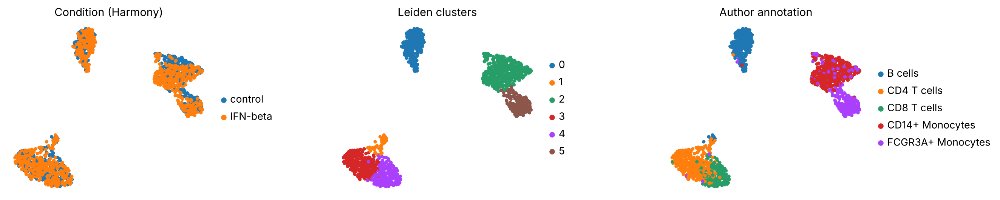
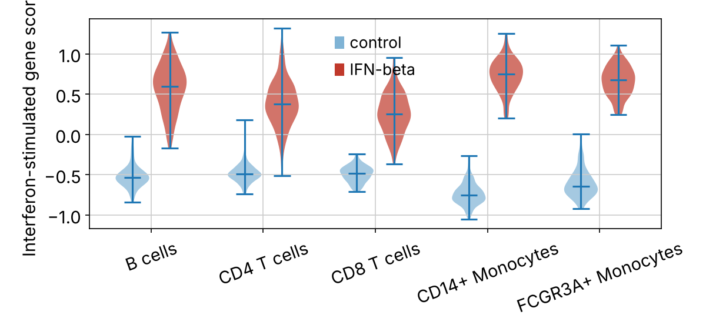
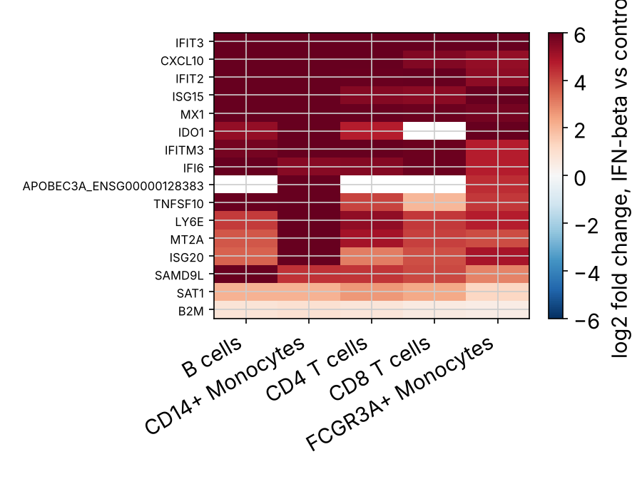

# Interferon-beta response in human PBMCs at single-cell resolution

A reproducible single-cell RNA-seq analysis in Python (Scanpy, Harmony, and PyDESeq2) of peripheral blood mononuclear cells stimulated with interferon-beta, using data from Kang and colleagues (2018, GEO [GSE96583](https://www.ncbi.nlm.nih.gov/geo/query/acc.cgi?acc=GSE96583)). The analysis takes the data from raw counts through quality control, normalization, integration across samples, clustering and marker-based annotation, and then measures the interferon response in each cell type with a pseudobulk differential expression analysis that treats the sample, not the cell, as the unit of replication.

The executed notebook, with code, figures, and interpretation, is [`notebooks/analysis.ipynb`](notebooks/analysis.ipynb); the same analysis in plain-text form is [`notebooks/analysis.py`](notebooks/analysis.py).

## Data

The data are the subset of the Kang et al. study distributed with the Bioconductor package muscat (Crowell et al., 2020): two donors, each with a control and an IFN-beta-stimulated sample, 1,556 cells and 1,267 genes, with the authors' annotation of five cell types (B cells, CD4 T cells, CD8 T cells, CD14+ monocytes, and FCGR3A+ monocytes). `scripts/export_from_muscat.R` exports the object to a Matrix Market count file and two CSV tables in `data/`.

## Workflow

1. Quality control: UMIs and genes per cell by sample, with light filtering of cells and genes.
2. Library-size normalization and log transformation; 600 highly variable genes selected with the Seurat v3 method across samples; PCA.
3. A UMAP without integration, which shows cells separating by condition rather than by type, the classic difficulty of this data set.
4. Harmony integration across the four samples, Leiden clustering, and UMAP of the integrated embedding.
5. Cell type annotation from canonical markers (a dot plot and per-cluster marker scores), compared with the authors' labels by adjusted Rand index.
6. A per-cell interferon-stimulated gene (ISG) score across cell types and conditions.
7. Pseudobulk differential expression: counts summed within each sample and cell type, then compared with PyDESeq2 using the paired design `~ donor + condition`.

## Results in brief

| | Result |
| --- | --- |
| Agreement of data-driven annotation with author labels | adjusted Rand index 0.80; disagreements confined to CD4 versus CD8 T cells and the two monocyte subsets |
| Genes changed by IFN-beta (pseudobulk, FDR below 5%) | CD14+ monocytes 337, FCGR3A+ monocytes 144, CD4 T cells 80, B cells 35, CD8 T cells 13 |
| Canonical ISGs (18 genes) up more than twofold | 100% in every cell type |
| ISG15, log2 fold change | 5.4 to 8.2 across the five cell types |
| MX1, log2 fold change | 5.7 to 6.7 across the five cell types |

Without integration, stimulation dominates the embedding; after Harmony integration, clustering and marker-based annotation recover the published cell types. Every cell type mounts a strong interferon response, with monocytes showing the broadest one. Because each cell type has only two donors per condition, the pseudobulk tests have few residual degrees of freedom: strong responses such as those of the ISGs are detected clearly, while subtler, cell-type-specific changes would need more donors, a limitation the notebook states rather than hides by treating cells as replicates.

## Figures

| | |
| --- | --- |
|  |  |
|  |  |

## Repository layout

```
data/counts.mtx.gz                  raw UMI counts (genes x cells, Matrix Market)
data/genes.csv, data/cells.csv      gene symbols and Ensembl IDs; sample, donor, condition, author cell type
scripts/export_from_muscat.R        exports the data from the muscat package
notebooks/analysis.py               the analysis (jupytext percent format)
notebooks/analysis.ipynb            the executed notebook
results/figures/                    QC, UMAPs, marker dot plot, ISG score, fold-change heatmap, monocyte volcano
results/tables/                     annotation agreement, pseudobulk results for every cell type, summary
requirements.txt                    Python package versions used
```

## How to run

```
python -m venv .venv && source .venv/bin/activate
pip install -r requirements.txt
jupytext --to ipynb notebooks/analysis.py -o notebooks/analysis.ipynb
cd notebooks && jupyter execute analysis.ipynb
```

The analysis was run with Python 3.13 and the package versions in `requirements.txt`.

## References

Crowell, H. L., Soneson, C., Germain, P.-L., et al. (2020). muscat detects subpopulation-specific state transitions from multi-sample multi-condition single-cell transcriptomics data. *Nature Communications, 11*, 6077.

Kang, H. M., Subramaniam, M., Targ, S., et al. (2018). Multiplexed droplet single-cell RNA-sequencing using natural genetic variation. *Nature Biotechnology, 36*, 89–94.

## Author

Patricia K. Kamanda. Released under the MIT License.
